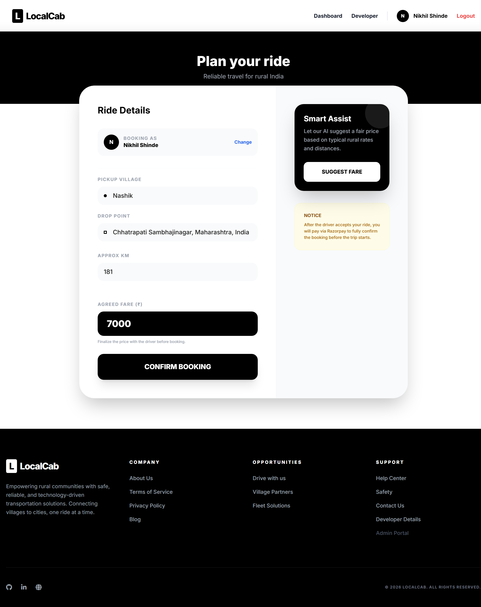
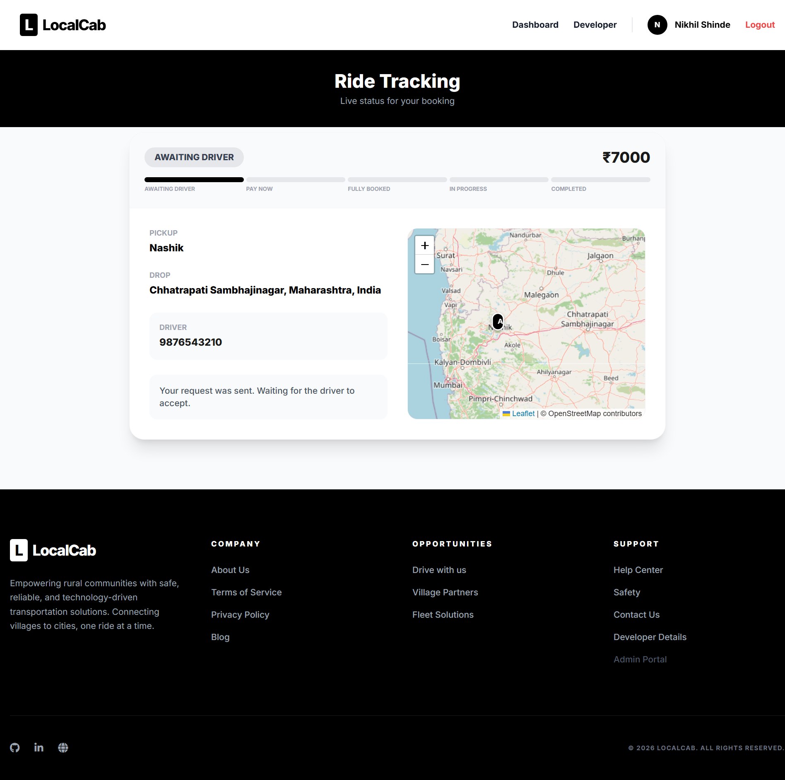
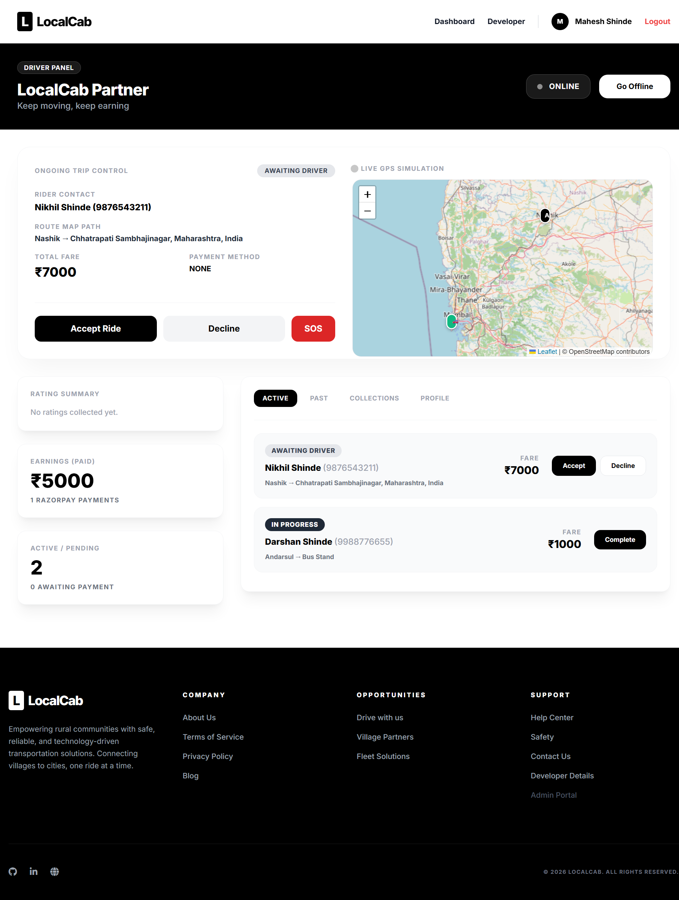
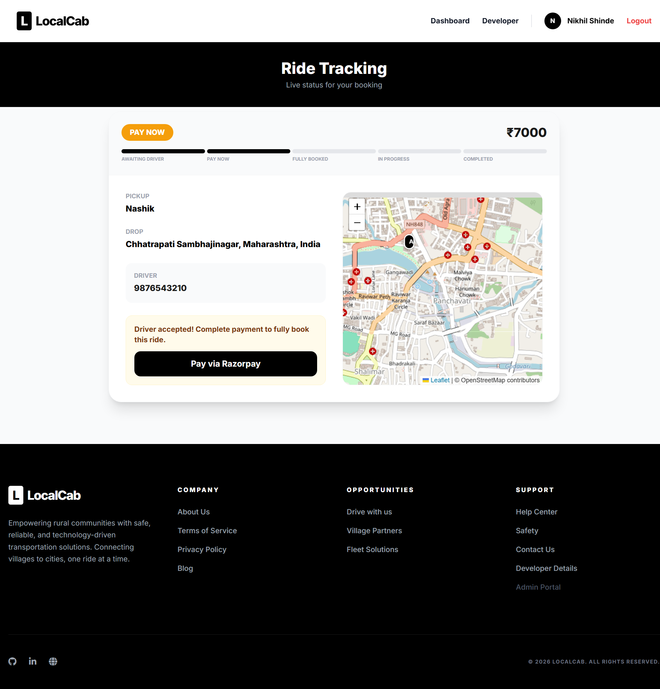
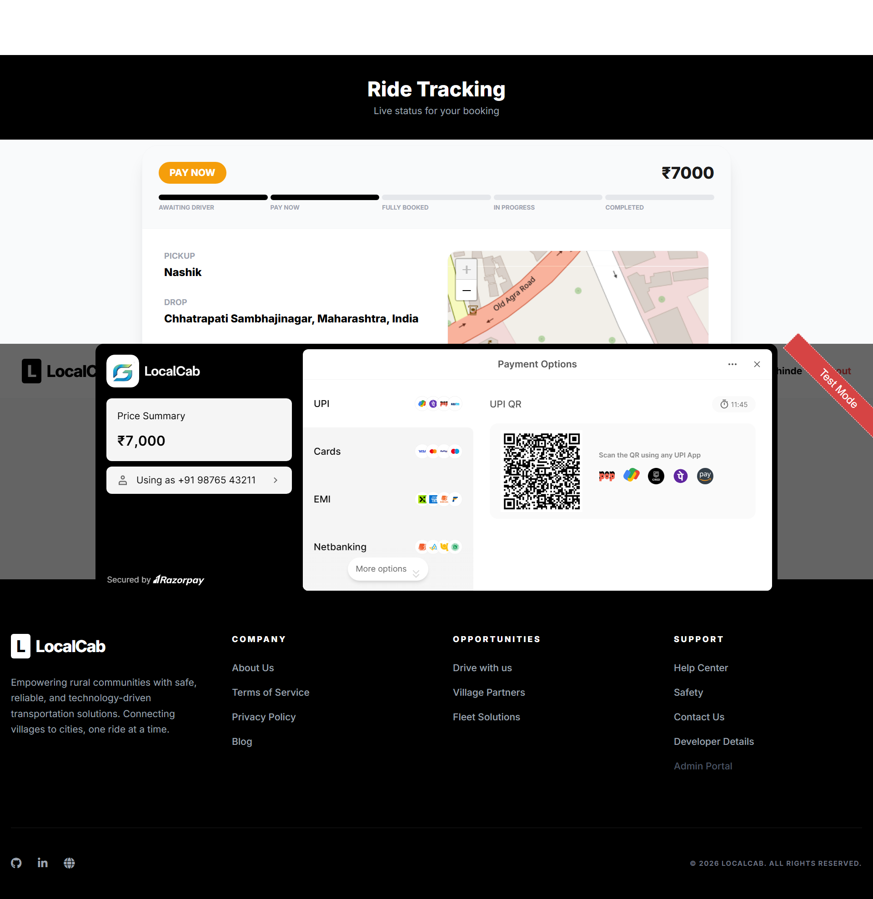
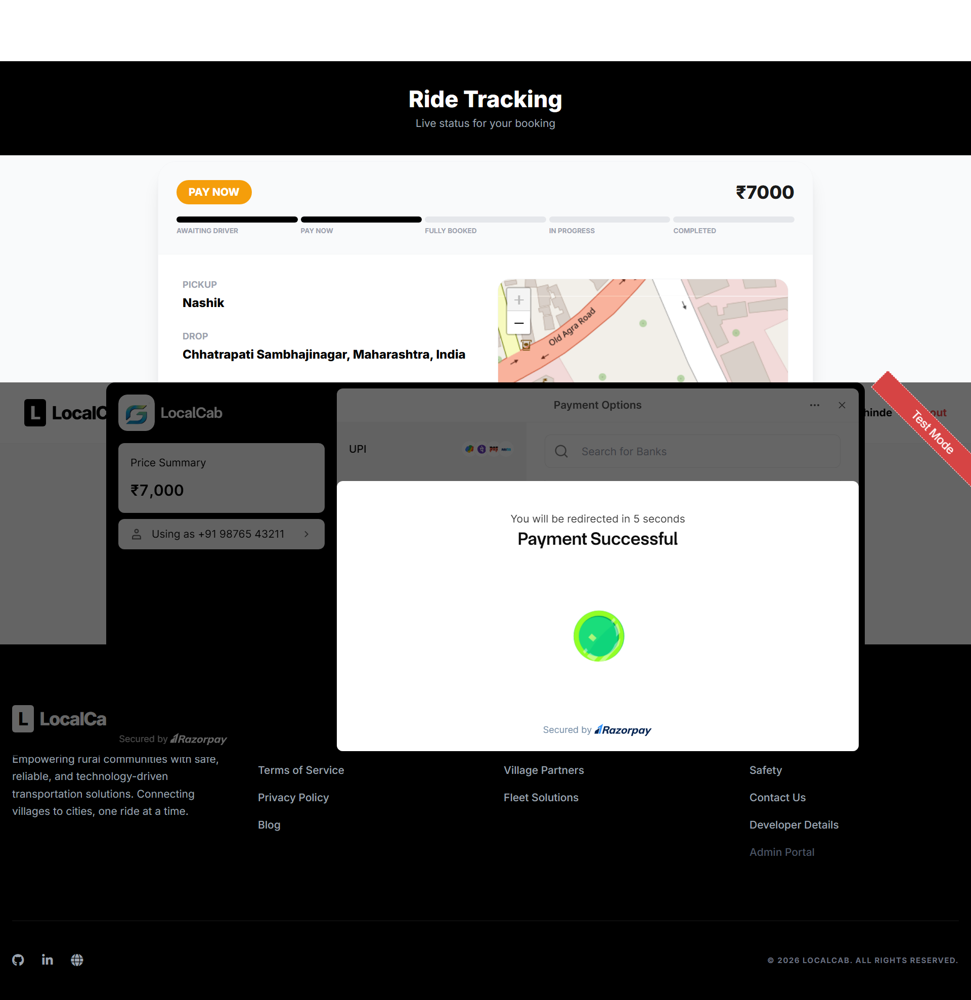
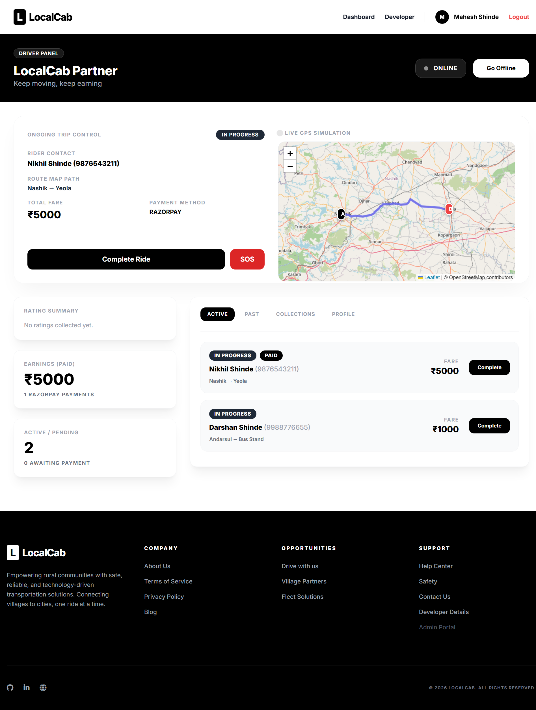

# LocalCab – Ride Booking and Payment Flow

## 1. Client Side – Enter Ride Details
The client enters the pickup location, destination, and other required details. The client offers a fair price for the ride, which is shared with the driver.

## 2. Client Side – Waiting for Driver
After submitting the ride request, the client waits for the driver to accept or reject the ride request.

## 3. Driver Side – Accept or Reject Ride
The driver reviews the ride request and the offered fare. The driver can either accept or reject the request. Once accepted, the client proceeds to payment.

## 4. Client Side – Make Payment
After the driver accepts the ride, the client proceeds to the payment page to pay the agreed fare.

## 5. Client Side – Razorpay Payment Gateway
The client completes the payment through the Razorpay payment gateway using the available payment options, including QR code payment if supported.

## 6. Client Side – Payment Successful
After successful payment confirmation, the client sees the payment status and waits for the driver to arrive at the pickup location.

## 7. Driver Side – Complete the Ride
After dropping the client at the destination, the driver marks the ride as completed in the application.

---

## Overall Workflow

1. Client enters ride details and offers a fair price.
2. Client submits the request and waits for the driver.
3. Driver accepts or rejects the ride request.
4. If accepted, the client proceeds to payment.
5. Client pays through the Razorpay gateway.
6. After payment confirmation, the client waits for the driver.
7. Driver drops the client at the destination and marks the ride as completed.

**Technologies:** Spring Boot, MongoDB, Razorpay Payment Gateway, and web-based client and driver interfaces.
